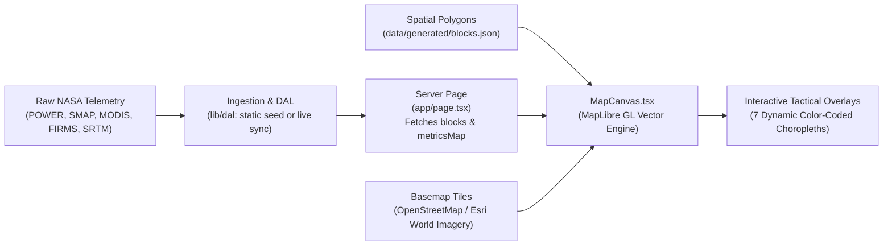

<picture>
  <source media="(prefers-color-scheme: dark)" srcset="https://shieldcn.dev/header/gradient.svg?title=AgriClimate&subtitle=NASA%20Satellite-Powered%20Climate%20Intelligence%20for%20Agricultural%20Resilience&mode=dark&theme=emerald&size=lg&font=inter">
  <source media="(prefers-color-scheme: light)" srcset="https://shieldcn.dev/header/gradient.svg?title=AgriClimate&subtitle=NASA%20Satellite-Powered%20Climate%20Intelligence%20for%20Agricultural%20Resilience&mode=light&theme=emerald&size=lg&font=inter">
  
</picture>

<p align="center">
  <a href="https://github.com/kynatians/agriclimate/actions/workflows/ci.yml">
    <picture>
      <source media="(prefers-color-scheme: dark)" srcset="https://shieldcn.dev/github/ci/kynatians/agriclimate.svg?workflow=ci.yml&branch=main&variant=outline&mode=dark">
      <source media="(prefers-color-scheme: light)" srcset="https://shieldcn.dev/github/ci/kynatians/agriclimate.svg?workflow=ci.yml&branch=main&variant=outline&mode=light">
      
    </picture>
  </a>
  <picture>
    <source media="(prefers-color-scheme: dark)" srcset="https://shieldcn.dev/badge/License-Apache_2.0-22c55e.svg?logo=apache&variant=outline&mode=dark">
    <source media="(prefers-color-scheme: light)" srcset="https://shieldcn.dev/badge/License-Apache_2.0-22c55e.svg?logo=apache&variant=outline&mode=light">
    
  </picture>
  <picture>
    <source media="(prefers-color-scheme: dark)" srcset="https://shieldcn.dev/github/last-commit/kynatians/agriclimate.svg?variant=outline&mode=dark">
    <source media="(prefers-color-scheme: light)" srcset="https://shieldcn.dev/github/last-commit/kynatians/agriclimate.svg?variant=outline&mode=light">
    
  </picture>
</p>

<p align="center">
  <picture>
    <source media="(prefers-color-scheme: dark)" srcset="https://shieldcn.dev/badge/Next.js-16.3-000000.svg?logo=nextdotjs&variant=branded&mode=dark">
    <source media="(prefers-color-scheme: light)" srcset="https://shieldcn.dev/badge/Next.js-16.3-000000.svg?logo=nextdotjs&variant=branded&mode=light">
    
  </picture>
  <picture>
    <source media="(prefers-color-scheme: dark)" srcset="https://shieldcn.dev/badge/TypeScript-5.x-3178C6.svg?logo=typescript&variant=branded&mode=dark">
    <source media="(prefers-color-scheme: light)" srcset="https://shieldcn.dev/badge/TypeScript-5.x-3178C6.svg?logo=typescript&variant=branded&mode=light">
    
  </picture>
  <picture>
    <source media="(prefers-color-scheme: dark)" srcset="https://shieldcn.dev/badge/React-19-61DAFB.svg?logo=react&variant=branded&mode=dark">
    <source media="(prefers-color-scheme: light)" srcset="https://shieldcn.dev/badge/React-19-61DAFB.svg?logo=react&variant=branded&mode=light">
    
  </picture>
  <picture>
    <source media="(prefers-color-scheme: dark)" srcset="https://shieldcn.dev/badge/Tailwind_CSS-4.x-06B6D4.svg?logo=tailwindcss&variant=branded&mode=dark">
    <source media="(prefers-color-scheme: light)" srcset="https://shieldcn.dev/badge/Tailwind_CSS-4.x-06B6D4.svg?logo=tailwindcss&variant=branded&mode=light">
    
  </picture>
  <picture>
    <source media="(prefers-color-scheme: dark)" srcset="https://shieldcn.dev/badge/MapLibre_GL-6.x-396CB2.svg?logo=maplibre&variant=branded&mode=dark">
    <source media="(prefers-color-scheme: light)" srcset="https://shieldcn.dev/badge/MapLibre_GL-6.x-396CB2.svg?logo=maplibre&variant=branded&mode=light">
    
  </picture>
  <picture>
    <source media="(prefers-color-scheme: dark)" srcset="https://shieldcn.dev/badge/pnpm-11-F69220.svg?logo=pnpm&variant=branded&mode=dark">
    <source media="(prefers-color-scheme: light)" srcset="https://shieldcn.dev/badge/pnpm-11-F69220.svg?logo=pnpm&variant=branded&mode=light">
    
  </picture>
</p>

<p align="center">
  <b>Climate intelligence & early warning platform powered by NASA satellite telemetry,<br>designed for smallholder farmers and agricultural extension officers.</b>
</p>

---

## ✨ Overview

**AgriClimate** is a NASA satellite data-powered climate intelligence and early warning platform designed for two complementary user groups:

1. **🌾 Smallholder Farmers** — Minimal, high-contrast, action-oriented advisory on weather, crop conditions, irrigation scheduling, and extreme weather alerts.
2. **📊 Agricultural Extension Officers** — Tactical GIS command center with block-level satellite layers, time-series anomaly monitoring, broadcast warning dispatch, and district telemetry reports.

Rather than fragmenting into separate apps, AgriClimate provides a unified application with a seamless **mode-switching architecture** — sharing a robust data access layer (DAL) while tailoring interfaces to each user's context and device.

---

## 🛰️ NASA Satellite Telemetry & Data Specifications

### Earth Observation Dataset Specifications

| Satellite / Dataset & Identifier | Spatial & Temporal Resolution | Exact Ingested Parameters & Bands | Derived Indices & Metrics | Where It Is Used in AgriClimate |
|---|---|---|---|---|
| **MODIS**<br>*(Terra & Aqua)*<br>`MOD13Q1.061`<br>`MOD11A1.061` | • 250 m (NDVI, 16-day composite)<br>• 1 km (LST, daily) | • Surface Reflectance Red (Band 1: 620–670 nm)<br>• Surface Reflectance NIR (Band 2: 841–876 nm)<br>• Daytime Land Surface Temp (`LST_Day_1km`, °C)<br>• Terra/Aqua cloud fraction & QA flags | • **NDVI**: `(NIR - Red) / (NIR + Red)`<br>• **NDVI Anomaly**: Deviation vs 10-year seasonal baseline (`% delta`)<br>• **CWSI**: Crop Water Stress Index input<br>• Vegetation health trajectory (`improving`, `stable`, `declining`) | • **Officer View**: *NDVI Vegetation Anomaly* & *Crop Water Stress (CWSI)* GIS map layers; block inspect drawer; district summary NDVI averages.<br>• **Farmer View**: *Crop Condition Card* (canopy greenness bar & health badge); *Crop Care Modal* (nitrogen/urea deficiency advisory); *Telemetry Detail Modal*.<br>• **Scoring Engine**: Crop Suitability Score (CSS) canopy recovery sub-score (10% weight). |
| **Landsat 8 & 9**<br>*(OLI-2 & TIRS-2)*<br>`landsat-c2-l2`<br>*(Planetary Computer STAC)* | • 30 m multispectral<br>• 8–16 day revisit | • Band 4 (Red: 0.64–0.67 µm)<br>• Band 5 (NIR: 0.85–0.88 µm)<br>• Band 3 (Green: 0.53–0.59 µm)<br>• Band 10 (TIRS Thermal Infrared) | • High-resolution 30 m **NDVI**<br>• **NDWI** (Normalized Difference Water Index) for surface water boundary delineation | • **Officer View**: Char land and riparian agricultural parcel monitoring along the Brahmaputra corridor; fine-scale zonal validation for smallholder plots.<br>• **Farmer View**: High-precision field boundary resolution referenced in *Crop Condition Card*.<br>• **Inundation Modeling**: Standing floodwater boundary demarcation and char erosion tracking. |
| **NASA SMAP**<br>*(Soil Moisture Active Passive)*<br>`SPL3SMP` (L3)<br>`SPL4SMGP` (L4) | • ~9 km (L4 assimilated, 3-hourly)<br>• ~36 km (L3 radiometer, 1–3 days) | • 0–5 cm Surface Soil Moisture (`soilMoistureSurface`, % VWC)<br>• 0–100 cm Root-Zone Soil Moisture (`soilMoistureRootZone`, % VWC)<br>• 5-year rolling seasonal baseline & anomaly | • **Soil Moisture Anomaly** (`% delta`)<br>• **Soil Saturation Ratio** (`current / saturationLimit`)<br>• **Deficit Severity Score** (0–100) for pump routing priority | • **Officer View**: *Root-Zone Soil Moisture* GIS map layer; *Pump Request Queue* review modal; block telemetry data table.<br>• **Farmer View**: *Soil Strata Visual* (0–5 cm surface vs 0–100 cm root-zone strata); *Solar Pumping Dial* (irrigation duration needed); *Weather Card* (soil status badge).<br>• **Early Warning**: Drought advisory (`anomaly < -20%`); waterlogging alert (`saturation > 90%`).<br>• **Hydro-Scheduler**: Priority pump dispatch queue; CSS soil moisture match (30% weight). |
| **GPM IMERG**<br>*(Global Precipitation Measurement)*<br>`GPM_3IMERGDF`<br>`GPM_3IMERGHH` | • 0.1° (~10 km)<br>• Half-hourly (Early/Late Run)<br>• Daily calibrated accumulation | • Calibrated precipitation rate (`precipitationCal`, mm/h)<br>• 7-day actual accumulated rainfall (`precip7dActual`, mm)<br>• 72-hour forecast precipitation total (`precip7dForecast`, mm) | • **SPI** (Standardized Precipitation Index, -3.5 to +3.5)<br>• **FSS** (Flood Susceptibility Score, 40% weight)<br>• Extreme precipitation threshold triggers (>80 mm / 48 h) | • **Officer View**: *Flood Susceptibility Score (FSS)* GIS map layer; Brahmaputra Inundation corridor hazard tracking; *Alert Composer* & feed.<br>• **Farmer View**: *Weather Card* (7-day rainfall forecast & rain probability); *Weather Horizon Strip*; *Alerts Feed* (flash flood & waterlogging warnings).<br>• **Scoring Engine**: CSS rainfall pattern match (20% weight); SPI drought trigger (SPI ≤ -1.0 advisory, SPI ≤ -1.5 warning). |
| **NASA POWER**<br>*(Agroclimatology)*<br>`GEOS-FP` / `MERRA-2` assimilation | • 0.5° × 0.625°<br>• Daily reanalysis<br>• Zero-auth REST API | • `T2M`: 2 m air temperature (°C)<br>• `PRECTOTCORR`: Corrected precipitation (mm/day)<br>• `ALLSKY_SFC_SW_DWN`: Solar irradiance (MJ/m²/day)<br>• `RH2M`: Relative humidity (%)<br>• `WS2M`: Wind speed (m/s) | • **VPD** (Vapor Pressure Deficit via Tetens equation)<br>• **CWSI** (Crop Water Stress Index, 0–1)<br>• 30-day agroclimatology time-series trends | • **Officer View**: *7-Day Rainfall Forecast* GIS map layer; historical time-series analytics charts (`/api/timeseries`); *Sync Live NASA Telemetry* engine.<br>• **Farmer View**: *Weather Card* (temperature, humidity, wind speed, solar radiation); *Crop Calendar View* (risk windows); *Solar Pumping Dial* (solar irradiance).<br>• **Scoring Engine**: CSS temperature sub-score (25% weight) and solar irradiance sub-score (15% weight). |
| **NASA FIRMS**<br>*(Fire Info for Resource Management)*<br>VIIRS & MODIS NRT | • 375 m (VIIRS NRT)<br>• 1 km (MODIS)<br>• ~3-hour latency | • `latitude`, `longitude`<br>• `acq_date`, `acq_time`<br>• `frp`: Fire Radiative Power (MW)<br>• `bright_ti4`, `bright_ti5`: Brightness temp (K)<br>• `confidence`: Detection confidence | • Thermal anomaly clustering<br>• FRP incident severity grading (High: >50 MW, Medium: >15 MW)<br>• Active agricultural fire & stubble burn event detection | • **Officer View**: *Thermal Anomalies & Stubble Burn* GIS map layer (`thermalFrp`); Incident Detail modal; real-time fire detection feed.<br>• **Farmer View**: Stubble burn alerts and field fire hazard advisories in *AlertsListView* and *AlertCard*.<br>• **Alert Dispatcher**: Auto-generates fire alerts with block-level geofencing and lead-time tracking. |
| **SRTM DEM**<br>*(Shuttle Radar Topography Mission)*<br>`SRTMGL1` | • 30 m (1 arc-second)<br>• Static global DEM | • Ground surface elevation (m MSL)<br>• Terrain slope gradient (°)<br>• Hydrological flow accumulation vectors | • **Terrain Flow Norm** (`terrainFlowNorm`)<br>• Low-lying depression and flood pooling susceptibility | • **Officer View**: Topographic layer (`osm-topo`) in map style switcher; river basin elevation gradients.<br>• **Flood Modeling**: FSS flood susceptibility calculation (25% weight) to identify low-lying catchment depressions prone to inundation. |
| **OpenStreetMap & Cartography**<br>*(OSM & Esri World Imagery)* | • Multi-scale raster tiles (z0–z19) | • OpenStreetMap vector road, waterbody & settlement networks<br>• Esri World Imagery aerial orthomosaics<br>• Administrative boundaries (GADM Bangladesh) | • Geospatial reference frame<br>• 12 Kurigram administrative monitoring block boundary polygons | • **Map Engine (`components/map/MapCanvas.tsx`)**: Basemap switcher (Standard OSM, Satellite Aerial, Topographic, Hybrid); interactive vector choropleth rendering. |

### 🧭 Telemetry Mapping by Application Feature

| Application Feature / Component | Primary Datasets Ingested | Exact Parameters & Role in Feature |
|---|---|---|
| **Farmer Weather Card** (`WeatherCard.tsx`) | NASA POWER, GPM IMERG | Displays daily temp (`T2M`), humidity (`RH2M`), wind (`WS2M`), 7-day rainfall forecast (`precip7dForecast`), and rain probability. |
| **Crop Condition Card** (`CropConditionCard.tsx`) | MODIS (MOD13Q1), Landsat 8/9, SMAP | Renders NDVI canopy vigor, anomaly vs 10-year baseline, vegetation recovery trend, and multi-spectral health status. |
| **Soil Strata Visualizer** (`SoilStrataVisual.tsx`) | NASA SMAP (SPL3SMP, SPL4SMGP) | Visualizes dual-depth soil moisture: surface (0–5 cm) vs deep root-zone (0–100 cm) % VWC against agronomic baselines. |
| **Solar Pumping Dial** (`SolarPumpingDial.tsx`) | NASA POWER, SMAP, MODIS | Computes daily irrigation deficit, available solar irradiance (`ALLSKY_SFC_SW_DWN`), and required pumping hours. |
| **Crop Recommendation Engine** (`lib/indices/css.ts`) | SMAP, MODIS LST, NASA POWER, Landsat | Computes Crop Suitability Score (CSS 0–100) across 5 weighted dimensions: Soil Moisture (30%), Temp (25%), Rainfall (20%), Solar (15%), NDVI (10%). |
| **Hydro-Scheduler Pump Dispatch** (`lib/dal/index.ts`) | SMAP, MODIS CWSI | Calculates block Deficit Severity (0–100) and sequences mobile solar pump assets to highest-deficit blocks. |
| **Drought & Flood Early Warnings** (`lib/indices/formulas.ts`) | GPM IMERG, SMAP, NASA POWER, SRTM | Triggers drought alerts (SPI ≤ -1.0, CWSI > 0.70) and flood warnings (FSS ≥ 0.70, rainfall > 80 mm / 48 h). |
| **Officer GIS Map Overlays** (`lib/map/layers.ts`) | MODIS, Landsat, SMAP, GPM, POWER, FIRMS, SRTM | Powers 7 interactive choropleth layers: NDVI Anomaly, Soil Moisture, Flood Risk (FSS), CWSI, 7d Precip, Pump Priority, and Fire/Heat. |
| **Live Telemetry Sync** (`app/api/sync/live-nasa`) | NASA POWER, NASA FIRMS | Real-time endpoint querying 12 Kurigram centroids and VIIRS fire bounding box with atomic file caching and SWR fallback. |

### 🗺️ GIS Map Visual Layers & Geospatial Pipeline

The interactive MapLibre GL engine ([`MapCanvas.tsx`](file:///home/tahsin/Documents/GitHub/kynatians/agriclimate/components/map/MapCanvas.tsx)) renders tactical GIS choropleth layers by combining **spatial vector boundaries** with **satellite telemetry**:

#### 1. The 7 Tactical GIS Choropleth Overlays

| Layer Name & ID | Primary Data Source | Metric Property Read (`BlockMetrics`) | Palette Type & Color Range | Visual & Operational Meaning |
|---|---|---|---|---|
| **NDVI Vegetation Anomaly**<br>`id: "ndvi"` | **MODIS** (`MOD13Q1`, 250m) & **Landsat 8/9** (30m) | `metrics.ndvi.anomaly` | Diverging (Army-Rose)<br>Green $\leftrightarrow$ Tan $\leftrightarrow$ Rose | Green indicates healthy canopy greenness above 10-year seasonal baseline; Rose/Brown highlights vegetation stress or flood damage. |
| **Root-Zone Soil Moisture**<br>`id: "soilMoisture"` | **NASA SMAP** (`SPL4SMGP` L4, 9km) | `metrics.soilMoistureRootZone.anomaly` | Diverging (Army-Rose)<br>Blue/Green $\leftrightarrow$ Red | Blue/Green indicates adequate 0–100 cm root-zone moisture; Red marks severe moisture deficits requiring pump intervention. |
| **Flood Susceptibility Score**<br>`id: "floodRisk"` | **GPM IMERG** (72h rain) + **SMAP** + **SRTM DEM** | `metrics.floodScore` (FSS formula 0–1) | Sequential (Flood)<br>Light Cyan $\rightarrow$ Deep Navy/Purple | Scores inundation vulnerability: FSS $\ge$ 0.70 flags acute flash flood / riverbank overflow risk along low-lying char plots. |
| **Crop Water Stress Index**<br>`id: "cropHealth"` | **MODIS LST** (`MOD11A1`) + **NASA POWER** + **SMAP** | `metrics.cwsi` (0.0 to 1.0) | Sequential (CWSI)<br>Yellow $\rightarrow$ Amber $\rightarrow$ Crimson | Quantifies plant transpiration deficit; CWSI $>$ 0.60 indicates critical moisture stress requiring evening irrigation. |
| **7-Day Rainfall Forecast**<br>`id: "precipForecast"` | **NASA POWER / GEOS-FP** & **GPM IMERG** | `metrics.precip7dForecast / 100` | Sequential (Sunset)<br>Amber $\rightarrow$ Purple | Visualizes projected numerical weather prediction accumulated rainfall (mm) across the upcoming week. |
| **Solar Pump Priority**<br>`id: "pumpRouting"` | **AgriClimate Hydro-Scheduler Engine** | Derived from CWSI & moisture deficit | Discrete Tiers<br>Optimal (Green) $\rightarrow$ Critical (Red) | Allocates solar pump hours dynamically; isolates high-deficit blocks needing emergency mobile pump routing. |
| **Thermal & Fire Events**<br>`id: "fireEvents"` | **NASA FIRMS** (VIIRS 375m NRT thermal channels) | `metrics.thermalFrp / 10` (MW) | Sequential (Sunset Heatmap)<br>Gold $\rightarrow$ Radiant Red | Spots near-real-time active agricultural stubble burns, crop residue clearing, and wildfire thermal anomalies. |

#### 2. Spatial Geometries & Basemap Providers

* **Administrative Block Polygons**: Stored in [`data/generated/blocks.json`](file:///home/tahsin/Documents/GitHub/kynatians/agriclimate/data/generated/blocks.json). Contains EPSG:4326 GeoJSON polygons and centroids for the 12 Kurigram monitoring blocks.
* **Active Disaster Corridors**: Defined in [`lib/map/disasters.ts`](file:///home/tahsin/Documents/GitHub/kynatians/agriclimate/lib/map/disasters.ts) as vector hazard zones (e.g. *Brahmaputra Riparian Inundation Corridor*, *Rajarhat Moisture Depletion Corridor*).
* **Basemap Tile Underlays**: Configured in [`lib/map/osm.ts`](file:///home/tahsin/Documents/GitHub/kynatians/agriclimate/lib/map/osm.ts) with instant runtime switching:
  * **Standard OSM**: OpenStreetMap vector roads, waterways, and settlement infrastructure.
  * **Topographic**: OpenTopoMap incorporating SRTM 30m contour gradients and elevation shading.
  * **Satellite Aerial / Hybrid**: High-resolution aerial orthomosaics from Esri World Imagery (Maxar, USGS) with administrative boundary overlays.

#### 3. Map Data Pipeline



---

## 🏗️ System Architecture

```
                 OFFLINE / INGESTION PIPELINE
┌──────────────────────────────────────────────────────────────┐
│  scripts/ingest/  (Python / TypeScript)                      │
│  NASA POWER · GPM · SMAP · MODIS · Landsat · FIRMS · SRTM    │
│      │  fetch & spatial zonal sampling                       │
│      ▼  compute indices (NDVI anom, SPI, FSS, CWSI)          │
│  writes → data/generated/*.json                              │
└──────────────────────────────────────────────────────────────┘
                               │
                               ▼
                   RUNTIME (Next.js App Router)
┌──────────────────────────────────────────────────────────────┐
│  app/api/*        Route handlers (Sync & dispatch)           │
│      │                                                       │
│      ▼                                                       │
│  lib/dal/         Pluggable DAL (Seed data + live adapters)  │
│  lib/indices/     Crop suitability scoring & risk formulas   │
│      │                                                       │
│      ▼                                                       │
│  app/(farmer) · app/(officer)   Responsive React UI          │
│      MapLibre GL · TanStack Query · Zustand · i18n           │
└──────────────────────────────────────────────────────────────┘
```

---

## 📁 Repository Structure

```
agriclimate/
├── app/                          # Next.js App Router
│   ├── (farmer)/                 # Farmer View routes (Home, Map, Calendar, Alerts)
│   ├── (officer)/                # Officer Control Panel GIS routes
│   ├── api/                      # Route handlers & Live NASA sync endpoints
│   ├── layout.tsx                # App shell, fonts, providers, metadata
│   └── globals.css               # Design system tokens & OKLCH color palettes
├── components/
│   ├── farmer/                   # Farmer View specialized components
│   ├── officer/                  # Officer GIS, table, feed & modal components
│   ├── map/                      # MapLibre GL map engine & tactical overlays
│   └── shared/                   # TopBar, ModeToggle, LanguageSwitcher, OfflineBanner
├── data/
│   ├── generated/                # Deterministic block-level telemetry & geojson
│   └── live/                     # Ephemeral cached live satellite feeds
├── docs/
│   ├── agriclimate.md            # Product & Planning Specification (v2.3)
│   ├── agriclimate-tech-spec.md  # Engineering Build Contract & Architecture (v1.0)
│   └── plans/                    # Frontend and Live NASA Ingestion Plans
├── lib/
│   ├── dal/                      # Data Access Layer & Live Data Adapters
│   ├── i18n/                     # Internationalization client (en / bn)
│   ├── nasa/                     # NASA API clients (POWER, FIRMS, Landsat)
│   └── stores/                   # Zustand state stores (UI, Map layers, Auth)
├── locales/
│   ├── en.json                   # English locale strings
│   └── bn.json                   # Bengali (বাংলা) locale strings
├── public/                       # Static assets & MapLibre Web Workers
├── scripts/                      # Satellite data ingestion pipelines
└── tests/                        # Vitest unit & component test suites
```

---

## 🚀 Getting Started

### Prerequisites

- **Node.js** 22+ LTS
- **pnpm** (version 10 or 11 recommended)

### Installation

1. **Clone the repository:**
   ```bash
   git clone https://github.com/kynatians/agriclimate.git
   cd agriclimate
   ```

2. **Install dependencies:**
   ```bash
   pnpm install
   ```

3. **Configure environment variables:**
   ```bash
   cp .env.example .env.local
   ```

> [!TIP]
> Defaults are pre-configured to operate in `hybrid` mode using deterministic seed data — **zero external setup required**.

4. **Run the development server:**
   ```bash
   pnpm dev
   ```
   Open [http://localhost:3000](http://localhost:3000) in your browser.

### Running Tests

```bash
# Run unit & component test suites
pnpm test

# Run linter
pnpm lint
```

---

## 📚 Documentation

| Document | Description |
|---|---|
| [Product & Planning Specification](docs/agriclimate.md) | Product vision, user research, feature definitions (v2.3) |
| [Engineering Technical Specification](docs/agriclimate-tech-spec.md) | Architecture, data models, build contract (v1.0) |
| [Frontend Implementation Plan](docs/plans/frontend-implementation-plan.md) | Component breakdown, routing, state management |
| [Live NASA Satellite Ingestion Plan](docs/plans/live-nasa-data-plan.md) | Pipeline design for real-time satellite data sync |
| [Project Roadmap & Status](roadmap.md) | Detailed implementation status and multi-phase roadmap |

---

## 🤝 Contributing

Contributions are welcome! Please feel free to submit a Pull Request. For major changes, open an issue first to discuss what you would like to change.

---

## 📄 License

This project is developed under **Kynatium Labs**. Licensed under the [Apache License 2.0](LICENSE).

NASA datasets are open and publicly accessible according to [NASA EOSDIS Open Data Policy](https://www.earthdata.nasa.gov/engage/open-data-services-and-software/data-and-information-policy).
